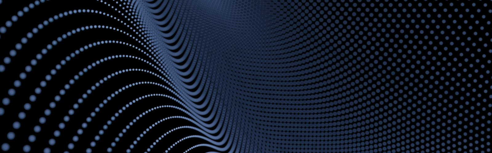



## Sabbir Hossain

**AI/ML Engineer · Full-Stack & Mobile Developer · Founder @ Velox Studio**

Nanjing, China · [sabbirhossainsm505@gmail.com](mailto:sabbirhossainsm505@gmail.com) · [veloxstudio.tech](https://veloxstudio.tech)

---

### About

I build AI products end to end — from model experiments to shipped applications. I'm a fourth-year Computer Science undergraduate at Nanjing University of Posts and Telecommunications (graduating 2027), and Founder & CTO at Velox Studio, where I lead architecture and engineering.

---

### Featured Project

| | |
|---|---|
| **Ultimate Workspace** | Local-first AI coding workspace (Relay): multi-agent orchestration, desktop app with auto-update, cloud-backed releases |
| **Live** | https://ultimate-workspace.netlify.app/ |

---

### Public Projects

| Project | What it is | Stack |
| --- | --- | --- |
| **[Content-management](https://github.com/Sabbir505/Content-management)** | Content discovery and creation tool for creators (Outlierly / TubeForge) | Next.js, TypeScript |
| **[EyeShield](https://github.com/Sabbir505/EyeShield)** | Forced eye-break enforcement desktop app for Windows and Linux | Electron, Python |
| **[NoboGyan](https://github.com/Sabbir505/NOBOGYAN-)** | AI-native learning engine with a six-dimensional learner model and RAG-based tutoring | Python, LLM, RAG |
| **[Multimodel-algorithm-for-emotion-detection](https://github.com/Sabbir505/Multimodel-algorithm-for-emotion-detection)** | Hybrid tensor-attention fusion for multimodal emotion recognition from physiological signals | Python, ML |
| **[4H-supertrend-trend-following-s](https://github.com/Sabbir505/4H-supertrend-trend-following-s)** | Automated 4H Supertrend scanner for Binance USDT pairs with Telegram alerts | Next.js, Python |
| **[TrendScale-pro-osc](https://github.com/Sabbir505/TrendScale-pro-osc)** | Trend oscillator (RSI + SDO + EOT) for trend-following entries | Pine Script |
| **[PersonalModelBench](https://github.com/Sabbir505/PersonalModelBench)** | Benchmarking harness for personal LLM models | Python |
| **[relay-releases](https://github.com/Sabbir505/relay-releases)** | Public releases and auto-update feed for Relay | Electron |
| **[exercisedb-api](https://github.com/Sabbir505/exercisedb-api)** | ExerciseDB API — 11,000+ exercises | Node.js |

---

### Also Building (Private)

Relay (AI coding workspace), KineticPulse, HabitSyncer, and more.

---

### Connect

[GitHub](https://github.com/Sabbir505) · [Email](mailto:sabbirhossainsm505@gmail.com) · [Velox Studio](https://veloxstudio.tech) · [X](https://twitter.com/SabbirHoss50140)
